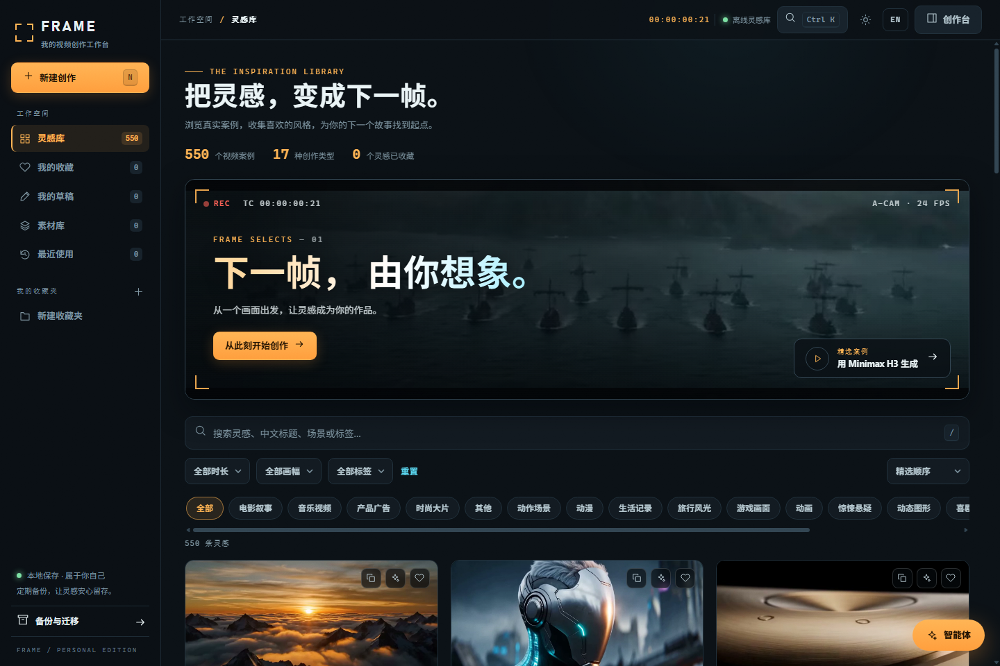
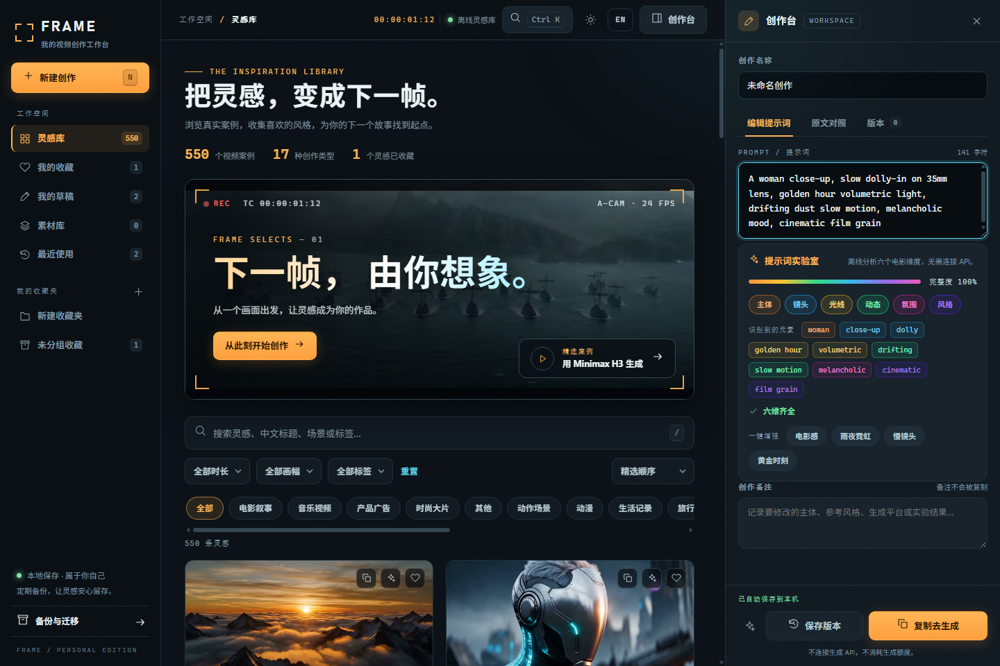
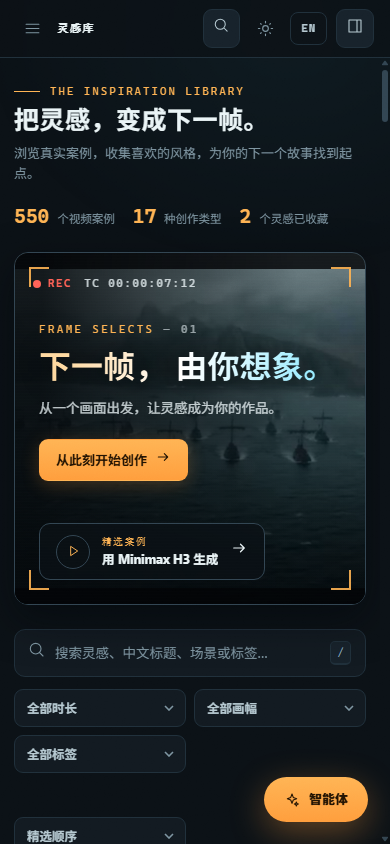

# FRAME · 放映室

个人视频生成提示词工作台：内置 550 条 MiniMax H3 分镜提示词与本地缩略图，集提示词实验室、智能体助手、素材库于一体。原生 HTML/CSS/JS + Python 标准库实现，零运行时依赖，单文件即可完全离线使用。



| 提示词实验室 | 移动端 |
| --- | --- |
|  |  |

## 功能

- **分镜库**：550 条视频提示词，缩略图全部本地化；支持关键词搜索、时长 / 画幅 / 分类筛选、相似分镜推荐
- **收藏与标签**：按收藏夹分组、自定义标签，支持 JSON 备份导出 / 导入
- **中英双语界面**，深色 / 浅色主题一键切换
- **提示词实验室**：草稿编辑、版本历史、创作笔记；提示词解剖、智能补全、一键增强
- **智能体助手**：接入你自己的 LLM 与文生图 API，基于所选分镜优化提示词、生成关键帧图片
- **素材库**：生成的图片与提示词按组保存，随时插入草稿复用
- **效率工具**：命令面板、最近使用、卡片一键复制、撤销
- **完全离线**：数据与缩略图全部内嵌进单个 HTML 文件，断网可用

## 快速开始

需要 Python 3.8+（仅标准库，无需安装任何依赖）。

### 方式一：直接打开（纯前端）

双击 `video-prompt-studio.html` 即可浏览、搜索、收藏、编辑提示词。此模式下智能体联网功能受浏览器跨域限制，建议用方式二。

### 方式二：本机服务（推荐，完整功能）

```bash
python start_studio.py
```

自动打开 http://127.0.0.1:8787 。页面与 API 中转同源，智能体请求不再受 CORS 限制。

可选参数：

```bash
python start_studio.py --port 8789      # 更换端口
python start_studio.py --no-browser     # 不自动打开浏览器
```

仓库还附带经典版页面 `minimax-h3-prompt-assistant.html`（早前的轻量助手），同样可直接打开。

## 智能体配置

1. 用方式二启动服务，打开页面右下角的「智能体助手」→「智能体设置」
2. 填写你的网关地址（OpenAI 兼容接口，如 `https://你的网关/v1`）、API Key、模型名；文生图接口同理
3. 点「测试连接」确认可用，然后从任意分镜卡片插入智能体，即可优化提示词或生成关键帧图片

**安全说明**

- API Key 只保存在浏览器 localStorage，不写入任何文件、不上传任何服务器
- 本机服务仅绑定 `127.0.0.1`，校验 Host 与 `X-Studio-Relay` 请求头，不发送开放 CORS 头，其他网站无法调用
- 请求链路只有：浏览器 → 本机进程 → 你自己的网关，不经过任何第三方
- 支持 SSE 流式输出

## 快捷键

| 按键 | 功能 |
| --- | --- |
| `Ctrl/⌘ + K` | 命令面板 |
| `/` | 聚焦搜索框 |
| `N` | 新建草稿 |
| `Ctrl/⌘ + S` | 保存状态 |

## 构建

修改 `studio.template.html` / `studio.css` / `studio.js` 后重新生成单文件页面：

```bash
python build_studio.py     # 输出 video-prompt-studio.html
node --check studio.js     # 语法检查（可选）
```

## 测试

```bash
# 单元测试（28 项）：构建产物完整性 + 本机服务行为
python -B -m unittest test_studio_build test_studio_server -q

# 浏览器端到端（45 项）：需先启动静态服务与无头 Chrome
python -m http.server 8786 --bind 127.0.0.1
# 另开终端：Chrome --headless=new --remote-debugging-port=9335 --user-data-dir=studio-test-artifacts/chrome-profile about:blank
node test_studio_browser.cjs

# 中继端到端（6 项）：自动拉起假上游 + 本机服务 + 无头 Chrome，测完自动清理
node test_studio_relay_browser.cjs
```

浏览器测试需要本机安装 Chrome 与 Node.js 22+（使用内置 WebSocket）。测试截图与结果输出在 `studio-test-artifacts/`。

## 离线分发包

`FRAME-studio-offline.zip`（约 50MB）包含单文件页面、启动脚本与全部 550 张缩略图，解压即用，适合拷到无网环境。

## 目录结构

```
├── video-prompt-studio.html          # FRAME 单文件成品（离线可用）
├── minimax-h3-prompt-assistant.html  # 经典版助手页面
├── start_studio.py                   # 本机服务：页面托管 + 同源 API 中转
├── studio.template.html              # FRAME 页面模板
├── studio.css / studio.js            # FRAME 样式与逻辑源码
├── build_studio.py                   # 单文件构建器
├── prompts.json                      # 550 条提示词数据
├── titles_zh.json / thumbs_ext.json  # 中文标题 / 缩略图扩展名映射
├── thumbs/                           # 550 张本地缩略图
├── scrape.py / download_thumbs.py / fix_meta.py  # 数据抓取与处理脚本
├── build_page.py                     # 经典版页面构建器
├── test_studio_build.py / test_studio_server.py  # 单元测试
├── test_studio_browser.cjs           # 浏览器端到端测试
├── test_studio_relay_browser.cjs     # 中继端到端测试
├── studio-test-artifacts/            # 测试截图与结果
└── FRAME-studio-offline.zip          # 离线分发包
```

## 数据来源

提示词与缩略图抓取自 [beatapi.io/minimax-h3-prompts](https://beatapi.io/minimax-h3-prompts)（共 550 条），版权归原作者所有，本仓库仅供个人学习与备份使用。

## 技术栈

- 前端：原生 HTML / CSS / JavaScript，无框架、无 npm 依赖
- 服务端：Python 标准库（`http.server` + `urllib`），单文件启动
- 测试：Python `unittest` + Node.js CDP 驱动的真实浏览器端到端测试